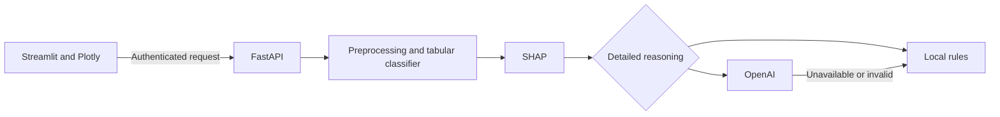

# Emergency Healthcare AI

Emergency departments use triage to prioritise assessments when demand exceeds immediately available resources. This academic prototype demonstrates acuity classification, case-level explanations and structured clinical reasoning with a Streamlit dashboard and a FastAPI backend.

**Decision-support only. Not a diagnosis. Confirm with a licensed clinician.** Use synthetic cases for demonstrations. Do not delay urgent care based on this application.

## Architecture



- `app.py` handles navigation, form validation, plots and per-session results.
- `backend/` contains API routes, schemas, auth, governance and reasoning.
- `ml/` contains preprocessing, model fitting, prediction, calibration, safety, fairness, registry and drift tooling.
- `data/dataset.csv` contains the existing dataset. `models/` holds generated artifacts.
- `tests/` covers the API, ML, validation, reasoning and dashboard.

## Local execution

Use Python 3.11. Check out `refactor/streamlit-openai` and run the following from the project directory.

```bash
python -m venv .venv
# Windows PowerShell: .venv\Scripts\Activate.ps1
# Linux/macOS: source .venv/bin/activate
python -m pip install -r requirements.txt
```

Copy `.env.example` to `.env`. Set `API_TOKENS` and `FRONTEND_API_TOKEN` to the same high-entropy token. The backend accepts comma-separated inference tokens and optional admin tokens. Existing local environment files may need updated values.

```bash
python -m ml.train
uvicorn backend.main:app --host 127.0.0.1 --port 8000
```

In a second terminal, run `streamlit run app.py`. The dashboard is at http://localhost:8501 and the API documentation is at http://localhost:8000/docs.

| Variable | Purpose |
|---|---|
| `OPENAI_API_KEY` | Optional backend credential. Local rules require no external connection. |
| `OPENAI_MODEL` | Configurable chat model, defaults to `gpt-4o-mini` |
| `LLM_TIMEOUT_SECONDS` | Reasoning deadline, defaults to five seconds |
| `API_TOKENS`, `ADMIN_TOKENS` | Backend bearer credentials |
| `BACKEND_URL`, `FRONTEND_API_TOKEN` | Streamlit server connection settings |
| `MODEL_DIR`, `AUDIT_LOG_DIR`, `LOG_LEVEL` | Artifact directory, audit directory, logging level |

## Data and model

The CSV contains encounter identifiers, age, recorded gender, chief complaint, arrival hour, blood pressure, heart and respiratory rates, temperature, oxygen saturation, pain, and the acuity target. Training excludes validation encounters prefixed with `VT`. The original data card leaves provenance, collection dates and geography unverified. The prototype supports four classes from Critical through Less Urgent. Standard ESI has five levels.

Candidates are XGBoost, LightGBM, CatBoost, logistic regression and an MLP. Training fits preprocessing within training folds, including MICE and complaint encoding. Model selection uses stratified cross-validation macro F1. A separate split is used to attempt probability calibration and an independent split supplies held-out metrics. The model directory contains the fitted artifacts, evaluation report, and feature drift reference. Use trusted artifacts only. Legacy local artifacts can load from `ml_runs`; retrain to obtain versioned evaluation and shared fitted preprocessing.

The original project flags single-snapshot measurements and sparse critical cases as limitations. Historical safety review targets were ESI 1 recall of at least 0.80 and a critical miss rate of at most 0.02. These targets do not establish clinical readiness.

The Model Performance page reports actual artifact metrics, including cross-validation results and available held-out safety and subgroup metrics. The supplied data has 28 distinct normalised complaints, each associated with a single acuity label. Internal row splits can repeat these complaint categories and overstate generalisation to unseen complaints. The supplied data also contains duplicate feature rows. These are internal estimates. External validation, prospective evaluation, fairness across unrecorded groups, and real clinical readiness remain future work.

SHAP explains the underlying classifier score for each available class. When calibration is applied, SHAP still explains the base classifier. Attribution is model behaviour and does not establish medical causation. Missing inputs are reported separately from observed inputs.

## API and reasoning

| Endpoint | Purpose |
|---|---|
| GET `/v1/health` | API liveness |
| GET `/v1/ready` | Model readiness |
| GET `/v1/version` | API and model versions |
| GET `/v1/status` | Model and reasoning configuration summary |
| GET `/v1/performance` | Authenticated evaluation report |
| GET `/v1/metrics` | Operational counters and latency |
| POST `/v1/predict` | Authenticated classification and available SHAP |
| POST `/v1/triage` | Authenticated detailed assessment with rationale |

OpenAI is the only external generative AI provider. The backend sends allowlisted vitals and prediction context plus a scrubbed complaint, validates the response, and falls back to local Python rules on failure or deadline expiry. Model acuity stays fixed. OpenAI API usage can incur separate charges. Status reports configuration without sending a request.

Tokens stay server-side. Audit entries omit complaints and raw encounter identifiers. Pattern-based free-text scrubbing is limited and cannot guarantee de-identification. Restrict access to the dashboard and backend, use TLS at the deployment boundary, and keep secrets, model files and audit logs in controlled storage. The software has no clinical validation or regulatory approval established by this project.

## Docker and hosting

Configure the authentication values in `.env`, then run `docker compose up --build`. The API image trains during build. This can take several minutes and requires CPU and memory for all candidates. The frontend waits for API readiness. Compose binds both ports to the local interface and persists API audit logs in a named volume.

On Render, create two Python 3.11 services in the same region from the refactor branch. Use a private backend service where available. Build the backend with `pip install -r requirements.txt && python -m ml.train --output-dir models`. Start it with `uvicorn backend.main:app --host 0.0.0.0 --port "$PORT"`. Build the dashboard with `pip install -r requirements.txt` and start it with `streamlit run app.py --server.address 0.0.0.0 --server.port "$PORT"`. Set `BACKEND_URL` to the internal service URL and configure matching token values in the platform secret manager. Set OpenAI credentials only on the backend. Persist audit logs on managed storage if required, and keep the model in the build output or on a trusted persistent volume. Size the service against measured training and startup requirements before using a small instance. A hosted dashboard requires restricted access because it sends the configured backend token for its users.

See [Render private networking](https://render.com/docs/private-network), [web service configuration](https://render.com/docs/web-services), and [persistent disks](https://render.com/docs/disks). The two container targets can also run on other Docker-compatible hosts.

## Verification

```bash
python -m compileall app.py backend ml
python -m pytest -v
python -m pip check
```

Automated reasoning tests mock the OpenAI SDK. No live key is needed.
