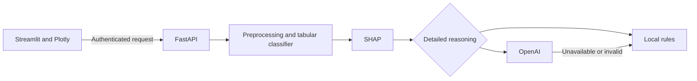

# Emergency Healthcare AI

Emergency departments use triage to prioritise assessments when demand exceeds immediately available resources. This academic prototype demonstrates acuity classification, case-level explanations and structured clinical reasoning with a Streamlit dashboard and a FastAPI backend.

**Decision-support only. Not a diagnosis. Confirm with a licensed clinician.** Use synthetic cases for demonstrations. Do not delay urgent care based on this application.

## Architecture



- `app.py` handles navigation, form validation, plots and per-session results.
- `backend/` contains API routes, schemas, auth, governance and reasoning.
- `ml/` contains preprocessing, model fitting, prediction, calibration, safety, fairness, registry and drift tooling.
- `data/` contains the original and simulated datasets, plus the local Excel workbook after assessments are saved.
- `models/` holds active model artifacts. `outputs/` holds local evaluations, archives and audit records.
- `logs/` holds local service logs. `.venv311/` is the local Python environment.
- `tests/` covers the API, ML, validation, reasoning and dashboard.

## Local execution

Use Python 3.11. Check out `refactor/streamlit-openai` and run the following from the project directory.

```bash
python -m venv .venv
# Windows PowerShell: .venv\Scripts\Activate.ps1
# Linux/macOS: source .venv/bin/activate
python -m pip install -r requirements.txt
```

Copy `.env.example` to `.env`. Set `API_TOKENS` and `FRONTEND_API_TOKEN` to the same high-entropy token. The backend accepts comma-separated inference tokens and optional admin tokens. Existing local environment files may need updated values.

```bash
python -m ml.train
uvicorn backend.main:app --host 127.0.0.1 --port 8000
```

In a second terminal, run `streamlit run app.py`. The dashboard is at http://localhost:8501 and the API documentation is at http://localhost:8000/docs.

| Variable | Purpose |
|---|---|
| `OPENAI_API_KEY` | Optional backend credential. Local rules require no external connection. |
| `OPENAI_MODEL` | Configurable chat model, defaults to `gpt-4o-mini` |
| `LLM_TIMEOUT_SECONDS` | Reasoning deadline, defaults to five seconds |
| `API_TOKENS`, `ADMIN_TOKENS` | Backend bearer credentials |
| `BACKEND_URL`, `FRONTEND_API_TOKEN` | Streamlit server connection settings |
| `MODEL_DIR`, `AUDIT_LOG_DIR`, `LOG_LEVEL` | Artifact directory, audit directory, logging level |

## Data and model

The CSV contains encounter identifiers, age, recorded gender, chief complaint, arrival hour, blood pressure, heart and respiratory rates, temperature, oxygen saturation, pain, and the acuity target. Training excludes validation encounters prefixed with `VT`. The original data card leaves provenance, collection dates and geography unverified. The prototype supports four classes from Critical through Less Urgent. Standard ESI has five levels.

Candidates are XGBoost, LightGBM, CatBoost, logistic regression and an MLP. The pipeline reserves approximately 20% for an independent test before fitting. It groups repeated patient or encounter identifiers when present and duplicate model inputs, then uses five group-disjoint stratified development folds. Each fold fits its own MICE and other fitted transforms. The model and regularization configuration are selected on development macro F1. The leaderboard shows development selection scores; the held-out report estimates performance of the selected model on the same data source. The selected classifier is refit on one development subset and sigmoid calibration uses a separate development subset. The final test does not inform tuning or calibration. Technical safety and fairness metrics are descriptive.

The supplied CSV has unverified provenance. An audit found that every normalized complaint in the eligible cohort corresponded to exactly one recorded label. The old complaint target encoding could therefore act as a label lookup. New training excludes that encoding, target values, identifiers and other non-allowlisted fields. Chief complaint remains available for clinical reasoning. The original CSV is preserved. The source has no patient identifier or full timestamp, so patient-level dependence across distinct encounters and temporal generalization cannot be assessed.

The Model Performance page reads saved metrics for the loaded model. Evaluation JSON includes the full schema audit, missingness, bounds violations, correlations, class-wise quantiles, fold metrics, confusion matrix, probability calibration, fairness, and robustness. FastAPI loads the artifact directory configured by `MODEL_DIR` (default `models/`). To use an archive intentionally, set `MODEL_DIR` to that trusted directory. Retrain legacy artifacts to replace the label shortcut.

### Separate simulation experiment

`data/synthetic_triage_v1.csv` is a reproducible 6,000-row experiment. The generator samples latent simulated labels before producing overlapping presentations, correlated vitals, measurement variation, and missingness. Labels represent simulator design choices. The experiment neither replaces the original data nor supplies clinician-validated outcomes.

```bash
python -m ml.simulate --output data/synthetic_triage_v1_regenerated.csv
python -m ml.train --dataset data/synthetic_triage_v1.csv --source "Synthetic experiment v1 (simulated labels)" --output-dir outputs/sim-v1
```

### External validation data

- MIMIC-IV-ED v2.2 has de-identified triage-time complaints, numeric vitals, pain scores, stay and subject identifiers, and five-level clinician acuity. Its credentialed license requires PhysioNet credentials, designated CITI training and a signed data-use agreement. Missing fields and the five-versus-four-class mismatch need explicit handling, and grouping must use subject ID. No files were downloaded. [PhysioNet dataset and license](https://physionet.org/content/mimic-iv-ed/2.2/)
- The 2022 NHAMCS public-use ED survey has initial vitals and triage immediacy. Its un-imputed immediacy field has 27.8% nonresponse in the documented denominator. Survey design and weighting, label comparability, and missingness require analysis. CDC limits public-use data to statistical analysis and reporting and prohibits identification attempts or linkage with individually identifiable data. No files were downloaded. [CDC documentation](https://ftp.cdc.gov/pub/Health_Statistics/NCHS/dataset_documentation/nhamcs/doc22-ed-508.pdf) ? [CDC data-use agreement](https://www.cdc.gov/nchs/policy/data-user-agreement.html)

Clinical validation requires authorised clinician-labelled cohorts, a documented label mapping, patient-grouped and temporal or external site holdouts, adequate critical-class support, uncertainty and subgroup analysis, and prospective workflow evaluation.

SHAP explains the underlying classifier score for each available class. When calibration is applied, SHAP still explains the base classifier. Attribution is model behaviour and does not establish medical causation. Missing inputs are reported separately from observed inputs.

## API and reasoning

| Endpoint | Purpose |
|---|---|
| GET `/v1/health` | API liveness |
| GET `/v1/ready` | Model readiness |
| GET `/v1/version` | API and model versions |
| GET `/v1/status` | Model and reasoning configuration summary |
| GET `/v1/performance` | Authenticated evaluation report |
| GET `/v1/metrics` | Operational counters and latency |
| POST `/v1/predict` | Authenticated classification and available SHAP |
| POST `/v1/triage` | Authenticated detailed assessment with rationale |

OpenAI is the only external generative AI provider. The backend sends allowlisted vitals and prediction context plus a scrubbed complaint, validates the response, and falls back to local Python rules on failure or deadline expiry. Model acuity stays fixed. OpenAI API usage can incur separate charges. Status reports configuration without sending a request.

Tokens stay server-side. Audit entries omit complaints and raw encounter identifiers. Pattern-based free-text scrubbing is limited and cannot guarantee de-identification. Restrict access to the dashboard and backend, use TLS at the deployment boundary, and keep secrets, model files and audit logs in controlled storage. The software has no clinical validation or regulatory approval established by this project.

## Docker and hosting

Configure the authentication values in `.env`, then run `docker compose up --build`. The API image trains during build. This can take several minutes and requires CPU and memory for all candidates. The frontend waits for API readiness. Compose binds both ports to the local interface and persists API audit logs in a named volume.

On Render, create two Python 3.11 services in the same region from the refactor branch. Use a private backend service where available. Build the backend with `pip install -r requirements.txt && python -m ml.train --output-dir models`. Start it with `uvicorn backend.main:app --host 0.0.0.0 --port "$PORT"`. Build the dashboard with `pip install -r requirements.txt` and start it with `streamlit run app.py --server.address 0.0.0.0 --server.port "$PORT"`. Set `BACKEND_URL` to the internal service URL and configure matching token values in the platform secret manager. Set OpenAI credentials only on the backend. Persist audit logs on managed storage if required, and keep the model in the build output or on a trusted persistent volume. Size the service against measured training and startup requirements before using a small instance. A hosted dashboard requires restricted access because it sends the configured backend token for its users.

See [Render private networking](https://render.com/docs/private-network), [web service configuration](https://render.com/docs/web-services), and [persistent disks](https://render.com/docs/disks). The two container targets can also run on other Docker-compatible hosts.

## Verification

```bash
python -m compileall app.py backend ml
python -m pytest -v
python -m pip check
```

Automated reasoning tests mock the OpenAI SDK. No live key is needed.

## Excel assessment recording

Submitting the Streamlit triage form saves an assessment in
`data/patient_records.xlsx` (worksheet `Patient Records`). The backend creates
a Pending row and updates it to Completed or Failed. Keep the workbook closed
in Excel while saving on Windows. A service interruption may leave a Pending
row for review. Records and timestamps use UTC. Encounter IDs are hashed and
complaints are scrubbed before storage. Use a private, access-controlled
directory for this file and its backups.

Generate Random Demo Patient loads an editable scenario into the form.
Scenario categories guide generation and the model determines predicted acuity.
Only submitted assessments are saved. Use Synthetic Demo for demonstration inputs only. To record an authorised patient,
set the backend variable `PATIENT_RECORD_WRITERS` to a JSON object mapping
individual writer names to unique high-entropy credentials, separate from
the shared inference tokens. Select Authorised patient and provide the
assigned writer credential in the form. Keep pattern-based scrubbing
limitations in mind and avoid entering identifiers into free-text fields.

API clients may opt in using a UUID `Idempotency-Key` and an `X-Record-Type`
header with value `Synthetic Demo` or `Authorised patient`. The API also accepts
the legacy `Synthetic` value for existing clients. Authorised patient
requests additionally require `X-Patient-Writer-Token`. An identical retry
returns the stored prediction and ID without generating another assessment.
SHAP and generated narrative are returned with the original result only.
`PATIENT_RECORDS_PATH` configures storage. In Compose the workbook lives in
the API's persistent outputs volume.
